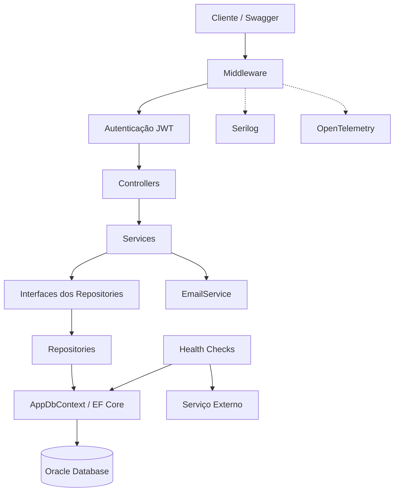

# ChupinVet Agenda API

---

# Integrantes

| Nome Completo | RM | Turma |
|---|---|---|
| Agatha Yie Won Yun | RM561507 | 2TDSA |
| Ana Claudia Fernandes Martins | RM561190 | 2TDSR |
| Samantha Faruolo Galdi | RM554794 | 2TDSA |
| Vitor Fria Dalmagro | RM566052 | 2TDSA |

---

# Sobre

API REST desenvolvida em ASP.NET Core para gerenciamento de horários e agendamentos veterinários, utilizando Oracle Database com Entity Framework Core.

O sistema permite que veterinários disponibilizem horários para atendimento e que responsáveis realizem agendamentos de consultas para seus pets.

---

# Como Instalar e Executar

## 1. Clonar o Repositório

```bash
git clone https://github.com/ChupinVet/ChupinVetAgenda.git
```

Entrar na pasta da solução:

```bash
cd ChupinVetAgenda
```

## 2. Restaurar as Dependências

Na raiz da solução, execute:

```bash
dotnet restore
```

## 3. Configurar o Banco de Dados

O projeto utiliza Oracle Database com Entity Framework Core.

A conexão é obtida pela configuração `ConnectionStrings:OracleConnection`.

Para executar a aplicação, é necessário configurar uma conexão válida com o Oracle no ambiente utilizado.

O arquivo de configuração fica em:

```text
ChupinVetAgenda/appsettings.json
```

## 4. Configurar a Autenticação JWT

A aplicação utiliza autenticação JWT para proteger os endpoints de horários e agendamentos.

Por segurança, a chave de assinatura deve ser armazenada no User Secrets do .NET, evitando sua exposição no código-fonte.

No terminal PowerShell, entre na pasta do projeto principal:

```powershell
cd ChupinVetAgenda
```

### Gerar uma chave JWT segura

Execute o comando abaixo para gerar uma chave aleatória de 64 bytes, codificada em Base64:

```powershell
$jwtKey = [Convert]::ToBase64String(
    [System.Security.Cryptography.RandomNumberGenerator]::GetBytes(64)
)
```

### Salvar as configurações no User Secrets

Execute:

```powershell
dotnet user-secrets set "Jwt:Key" "$jwtKey"
dotnet user-secrets set "Jwt:Issuer" "ChupinVetAgenda"
dotnet user-secrets set "Jwt:Audience" "ChupinVetAgendaAPI"
```

Essas configurações são utilizadas pela aplicação para gerar e validar os tokens JWT.

### Observações

- Cada desenvolvedor pode gerar sua própria chave JWT.
- A chave não deve ser publicada no GitHub.
- O User Secrets é utilizado no ambiente de desenvolvimento.
- O token JWT gerado após o login possui validade de 1 hora.
- Em produção, recomenda-se utilizar um gerenciador seguro de segredos ou variáveis de ambiente protegidas.

## 5. Aplicar as Migrations

Ainda na pasta do projeto principal, execute:

```bash
dotnet ef database update
```

Esse comando aplica as migrations existentes ao banco de dados configurado.

## 6. Executar a Aplicação

Na pasta do projeto principal, execute:

```bash
dotnet run
```

Também é possível executar a aplicação pelo botão Run do Rider.

## 7. Acessar o Swagger

Com a API em execução no ambiente de desenvolvimento, acesse:

```text
http://localhost:5139/swagger
```

A porta pode variar conforme a configuração do ambiente.

O Swagger permite visualizar e testar os endpoints da API.

Para acessar os endpoints protegidos, é necessário realizar o login e informar o token JWT no botão `Authorize`.

## 8. Verificar o Health Check

Com a aplicação em execução, acesse:

```http
GET /health
```

Exemplo:

```text
http://localhost:5139/health
```

O Health Check verifica a aplicação, a conexão com o Oracle e o serviço externo configurado.

## 9. Executar os Testes

Para executar todos os testes automatizados, volte à raiz da solução e execute:

```bash
dotnet test
```

Para gerar relatórios de cobertura:

```bash
dotnet test --collect:"XPlat Code Coverage"
```

---

# Tecnologias Utilizadas

- **Linguagem:** C#
- **Framework:** ASP.NET Core (.NET 10)
- **Banco de Dados:** Oracle Database
- **ORM:** Entity Framework Core
- **Autenticação:** JWT Bearer e ASP.NET Core Identity PasswordHasher
- **Documentação da API:** Swagger / OpenAPI
- **Persistência:** Repository Pattern e EF Core Migrations
- **Logging:** Serilog
- **Observabilidade:** OpenTelemetry
- **Monitoramento:** ASP.NET Core Health Checks
- **Testes unitários:** xUnit, Moq e Entity Framework Core InMemory
- **Testes de integração:** WebApplicationFactory
- **Cobertura de código:** Coverlet
- **IDE:** JetBrains Rider
- **Versionamento:** Git e GitHub

---

# Arquitetura do Projeto

A aplicação foi organizada em camadas, seguindo princípios de separação de responsabilidades, Clean Code, SOLID e injeção de dependências.

O objetivo é manter as regras de negócio separadas dos Controllers, facilitando a manutenção, a evolução e os testes automatizados.

## Organização das Camadas

### Controllers

Responsáveis por receber as requisições HTTP, validar as entradas conforme os contratos da API e retornar as respostas adequadas.

Os Controllers delegam as operações de negócio aos Services.

### Services

Responsáveis pela implementação das regras de negócio da aplicação.

Entre suas responsabilidades estão:

- Verificar a disponibilidade dos horários;
- Criar e atualizar agendamentos;
- Liberar horários após a exclusão de agendamentos;
- Impedir a exclusão de horários vinculados a agendamentos;
- Realizar o cadastro e a autenticação de usuários.

### Repositories

Responsáveis pelo acesso e persistência dos dados.

A aplicação utiliza o Repository Pattern, com interfaces e implementações para horários, agendamentos e usuários.

Os Services dependem das interfaces dos repositórios, reduzindo o acoplamento com a camada de persistência.

### Data

Contém o `AppDbContext`, responsável pelo mapeamento das entidades e pela comunicação com o banco de dados por meio do Entity Framework Core.

### Models

Contém as entidades utilizadas pela aplicação, como:

- `Agendamento`;
- `HorarioDisponivel`;
- `Usuario`.

### Middleware

Contém o tratamento global de exceções, permitindo centralizar respostas de erro e evitar a exposição de detalhes internos da aplicação.

## Fluxo de uma Requisição

O fluxo principal da aplicação segue esta estrutura:

```text
Cliente HTTP / Swagger
         |
         v
     Controllers
         |
         v
       Services
         |
         v
  Interfaces Repository
         |
         v
     Repositories
         |
         v
      AppDbContext
         |
         v
    Oracle Database
```

## Diagrama de Arquitetura

O diagrama abaixo representa a organização dos principais componentes da aplicação e o fluxo de comunicação entre as camadas.



### Componentes

- **Middleware:** tratamento global de exceções e identificação das requisições.
- **Autenticação JWT:** validação de tokens para acesso aos endpoints protegidos.
- **Controllers:** recebimento das requisições e retorno das respostas HTTP.
- **Services:** execução das regras de negócio.
- **Repositories:** acesso e persistência dos dados por meio de interfaces.
- **AppDbContext:** comunicação com o Oracle utilizando Entity Framework Core.
- **EmailService:** simulação de envio de e-mails de agendamento.
- **Serilog e OpenTelemetry:** logging, métricas e rastreamento.
- **Health Checks:** monitoramento do banco de dados e do serviço externo.

## Injeção de Dependências

A aplicação utiliza o mecanismo de injeção de dependências do ASP.NET Core para registrar e fornecer os componentes necessários.

Os Controllers recebem os Services por meio de interfaces, enquanto os Services utilizam interfaces de repositórios.

Essa organização facilita a substituição de implementações e a criação de testes automatizados.

## Princípios Aplicados

- **Single Responsibility Principle (SRP):** separação das responsabilidades entre Controllers, Services e Repositories;
- **Dependency Inversion Principle (DIP):** utilização de interfaces para reduzir o acoplamento;
- **Clean Code:** organização dos métodos e das responsabilidades;
- **Repository Pattern:** abstração do acesso aos dados;
- **Dependency Injection:** gerenciamento das dependências pelo ASP.NET Core.

---

# Funcionalidades

## Autenticação

- Cadastro de usuários;
- Login com geração de token JWT;
- Armazenamento seguro de senhas utilizando hash;
- Proteção dos endpoints de horários e agendamentos;
- Validação de tokens JWT.

## Horários

- Cadastrar horários disponíveis;
- Listar todos os horários;
- Listar apenas horários disponíveis;
- Buscar horários por ID;
- Atualizar horários;
- Remover horários sem agendamentos vinculados.

## Agendamentos

- Realizar agendamentos de consultas veterinárias;
- Listar agendamentos com paginação;
- Filtrar agendamentos por status e espécie;
- Ordenar agendamentos;
- Buscar agendamentos por ID;
- Buscar agendamentos por responsável;
- Visualizar agendamentos para veterinários;
- Atualizar agendamentos;
- Excluir agendamentos e liberar seus horários;
- Disponibilizar links HATEOAS;
- Simular envio de e-mail para novos agendamentos.

## Monitoramento e Qualidade

- Health Checks da aplicação, banco Oracle e serviço externo;
- Logs estruturados com Serilog;
- Rastreamento de requisições com Correlation ID;
- Traces e métricas com OpenTelemetry;
- Tratamento global de exceções;
- Testes unitários e de integração;
- Relatórios de cobertura de código.

---

# Autenticação e Segurança

A API utiliza autenticação JWT (JSON Web Token) para proteger os endpoints de horários e agendamentos.

O sistema permite o cadastro de usuários e a realização de login. Após a autenticação, o usuário recebe um token JWT que deve ser enviado nas requisições aos endpoints protegidos.

## Endpoints de Autenticação

### Registrar Usuário

```http
POST /api/Auth/registrar
```

Permite cadastrar um novo usuário no sistema.

As senhas são armazenadas utilizando hash, não sendo salvas em texto puro.

### Realizar Login

```http
POST /api/Auth/login
```

Valida as credenciais do usuário e retorna um token JWT quando a autenticação é realizada com sucesso.

## Utilizando o JWT no Swagger

1. Execute a aplicação e acesse o Swagger.
2. Utilize o endpoint de registro para cadastrar um usuário.
3. Realize o login utilizando as credenciais cadastradas.
4. Copie o token JWT retornado.
5. Clique no botão `Authorize` do Swagger.
6. Informe o token no campo de autenticação.
7. Confirme a autorização e execute os endpoints protegidos.

## Proteção dos Endpoints

Os controllers de horários e agendamentos exigem autenticação.

Requisições realizadas sem um token válido retornam:

```http
401 Unauthorized
```

O token JWT possui validade de 1 hora.

## Configuração Segura

A chave utilizada para assinar os tokens JWT não deve ser armazenada diretamente no código-fonte nem publicada no GitHub.

Durante o desenvolvimento, a aplicação utiliza o recurso User Secrets do .NET para armazenar a chave JWT.

As configurações de autenticação incluem:

- `Jwt:Key`: chave secreta de assinatura;
- `Jwt:Issuer`: emissor do token;
- `Jwt:Audience`: público destinatário do token.

Em produção, essas configurações devem ser fornecidas por um mecanismo seguro de gerenciamento de segredos.

---

# Banco de Dados

A aplicação utiliza Oracle Database para persistência dos dados, com Entity Framework Core como ferramenta de mapeamento objeto-relacional (ORM).

O acesso ao banco é realizado por meio do `AppDbContext` e dos repositórios da aplicação.


## Configuração da Conexão

A conexão com o Oracle Database é configurada por meio do arquivo `appsettings.json`, localizado no projeto principal.

A aplicação utiliza a configuração `ConnectionStrings:OracleConnection`, que é carregada pelo `AppDbContext` através do Entity Framework Core.

Para executar a aplicação em outro ambiente, é necessário configurar uma conexão válida com o Oracle Database.

## Migrations

O projeto utiliza migrations do Entity Framework Core para controlar a estrutura do banco de dados.

Para aplicar as migrations existentes:

```bash
dotnet ef database update
```

O comando deve ser executado na pasta do projeto principal, com a conexão Oracle devidamente configurada.

Caso a ferramenta `dotnet ef` não esteja instalada, será necessário instalá-la antes de executar as migrations.

## Persistência

A aplicação utiliza o Repository Pattern para organizar o acesso aos dados.

Os principais repositórios são:

- `AgendamentoRepository`;
- `HorarioRepository`;
- `UsuarioRepository`.

As operações de persistência são realizadas pelo Entity Framework Core, utilizando o `AppDbContext`.

---

# OpenAPI / Swagger

A documentação da API está disponível via Swagger.

Exemplo:

```bash
http://localhost:5139/swagger
```

---

# Documentação das Rotas

## Horários

### Listar todos os horários
```http
GET /api/Horarios
```
- Retorna todos os horários cadastrados.

### Listar horários disponíveis
```http
GET /api/Horarios/disponiveis
```
- Retorna apenas horários com status "Disponivel".

### Buscar horário por ID
```http
GET /api/Horarios/{id}
```
- Retorna apenas o horário com id compatível.

### Criar horário
```http
POST /api/Horarios
```
### Exemplo:
```JSON
{
  "dataHora": "2026-06-25T10:30:00",
  "tipoAtendimento": "Retorno",
  "status": "Disponivel"
}
```
- Cria um horário.

### Atualizar horário
```http
PUT /api/Horarios/{id}
```
### Exemplo:
```JSON
{
  "dataHora": "2026-06-25T10:30:00",
  "tipoAtendimento": "Vacinação",
  "status": "Ocupado"
}
```
- Atualiza um horário.

### Remover horário
```http
DELETE /api/Horarios/{id}
```
- Remove um horário caso ele não possua agendamentos vinculados.

## Agendamentos

### Listar Agendamentos com Paginação, Filtros e Ordenação

```http
GET /api/Agendamentos
```

Retorna os agendamentos cadastrados, permitindo consultar os resultados de forma paginada, filtrada e ordenada.

O endpoint exige autenticação JWT.

#### Parâmetros de Consulta

| Parâmetro | Tipo | Descrição |
|---|---|---|
| `pagina` | int | Número da página solicitada |
| `tamanhoPagina` | int | Quantidade de registros por página |
| `status` | string | Filtra pelo status do agendamento |
| `especie` | string | Filtra pela espécie do pet |
| `ordenarPor` | string | Campo utilizado na ordenação |
| `descendente` | bool | Define se a ordenação será decrescente |

Os campos aceitos para `ordenarPor` são:

- `nomepet`
- `nomeresponsavel`
- `status`

Quando não é informado um campo de ordenação reconhecido, a consulta utiliza o identificador do agendamento.

#### Exemplo de Requisição

```http
GET /api/Agendamentos?pagina=1&tamanhoPagina=5&status=Marcado&especie=Cachorro&ordenarPor=nomepet&descendente=false
```

Essa requisição consulta a primeira página, com até cinco agendamentos de cachorros com status `Marcado`, ordenados pelo nome do pet em ordem crescente.

#### HATEOAS

A API utiliza HATEOAS para disponibilizar links de navegação relacionados aos recursos retornados.

Na listagem paginada, podem ser disponibilizados os seguintes links:

| Relação | Descrição |
|---|---|
| `self` | Página atual |
| `primeira` | Primeira página |
| `anterior` | Página anterior, quando existir |
| `proxima` | Próxima página, quando existir |
| `ultima` | Última página |

Os links de navegação preservam os parâmetros de filtragem e ordenação utilizados na consulta.

### Buscar agendamento por ID
```http
GET /api/Agendamentos/{id}
```
- Retorna o agendamento compatível com o id informado.

A resposta também inclui links HATEOAS relacionados ao agendamento:

| Relação | Método HTTP | Descrição |
|---|---|---|
| `self` | GET | Consultar o agendamento |
| `atualizar` | PUT | Atualizar o agendamento |
| `excluir` | DELETE | Excluir o agendamento |

Esses links permitem identificar as operações disponíveis para o recurso.

### Buscar agendamentos por responsável
```http
GET /api/Agendamentos/responsavel/{email}
```
- Retorna todos os agendamentos feitos pelo responsável do email informado.

### Visualização do veterinário
```http
GET /api/Agendamentos/veterinario
```
- Retorna todos os agendamentos para o veterinário.

### Criar agendamento
```http
POST /api/Agendamentos
```
### Exemplo:
```JSON
{
  "horarioDisponivelId": 1,
  "nomeResponsavel": "Samantha Faruolo",
  "emailResponsavel": "samantha@email.com",
  "nomePet": "Thor",
  "especiePet": "Cachorro",
  "status": "Marcado"
}
```
- Cria um agendamento.

### Atualizar agendamento
```http
PUT /api/Agendamentos/{id}
```
### Exemplo:
```JSON
{
  "nomeResponsavel": "Samantha Faruolo",
  "emailResponsavel": "samantha@email.com",
  "nomePet": "Thor Atualizado",
  "especiePet": "Cachorro",
  "status": "Marcado"
}
```
- Atualiza um agendamento.

### Remover agendamento
```http
DELETE /api/Agendamentos/{id}
```
- Ao remover um agendamento, o horário relacionado volta para "Disponivel".

---

# Monitoramento e Observabilidade

A aplicação possui recursos de monitoramento e observabilidade para acompanhar sua disponibilidade e comportamento durante a execução.

## Health Checks

Foi implementado um endpoint de Health Check:

```http
GET /health
```

O Health Check verifica:
- Disponibilidade da aplicação;
- Conectividade com o banco de dados Oracle;
- Disponibilidade de serviço externo.

## Logging

A aplicação utiliza Serilog para geração de logs estruturados.

Os logs são registrados no console e em arquivos locais e utilizam diferentes níveis de severidade, como:

- Information;
- Warning;
- Error.

Também é utilizado um Correlation ID para facilitar o rastreamento das requisições.

## OpenTelemetry

O OpenTelemetry é utilizado para coleta de traces e métricas da aplicação.

A instrumentação permite acompanhar informações como:

- Requisições HTTP;
- Tempo de resposta;
- Status das requisições;
- Chamadas HTTP externas;
- Métricas da aplicação.

---

# Testes Automatizados

O projeto possui testes unitários e testes de integração utilizando xUnit, com o objetivo de validar as regras de negócio e o comportamento dos endpoints da API.

## Testes Unitários

Os testes unitários utilizam:

- xUnit;
- Moq;
- Entity Framework Core InMemory;
- Padrão AAA (Arrange, Act, Assert).

Foram implementados testes para:

- Cadastro de usuários e autenticação JWT;
- Validação de credenciais;
- Criação de agendamentos com horários indisponíveis ou inexistentes;
- Atualização de agendamentos existentes e inexistentes;
- Exclusão de agendamentos e liberação dos horários;
- Paginação, filtragem e ordenação de agendamentos;
- Criação e atualização de horários;
- Exclusão de horários disponíveis;
- Bloqueio da exclusão de horários com agendamentos vinculados.

## Testes de Integração

Os testes de integração utilizam `WebApplicationFactory`, Fixtures e um esquema de autenticação específico para o ambiente de testes.

Os cenários incluem:

- Verificação do Health Check;
- Listagem de horários com autenticação;
- Retorno HTTP 404 para horário inexistente;
- Retorno HTTP 401 para requisição sem autenticação.

## Executando os Testes

Na raiz da solução, execute:

```bash
dotnet test
```

Para executar apenas os testes unitários:

```bash
dotnet test ChupinVetAgenda.Tests.Unit/ChupinVetAgenda.Tests.Unit.csproj
```

Para gerar relatórios de cobertura:

```bash
dotnet test --collect:"XPlat Code Coverage"
```

## Resultados

A solução possui atualmente **29 testes automatizados**:

- 25 testes unitários;
- 4 testes de integração.

Na última execução registrada, os 25 testes unitários e os 4 testes de integração foram concluídos com sucesso, totalizando 29 testes automatizados sem falhas.

### Cobertura de Código

Últimos resultados obtidos com o Coverlet:

| Tipo | Cobertura de linhas | Cobertura de branches |
|---|---:|---:|
| Testes unitários | 20,84% | 12,24% |
| Testes de integração | 12,59% | 2,38% |

Os percentuais correspondem a relatórios separados, não à cobertura total combinada da solução.

---

# Melhorias Futuras

- Integração com nosso app mobile (ChupinVet);
- Sistema real de envio de e-mails;
- Notificações automáticas para consultas;
- Histórico de atendimentos dos pets.

---

# Observações

O sistema de envio de e-mails foi implementado apenas de forma simulada para demonstração da lógica de negócio da aplicação.
